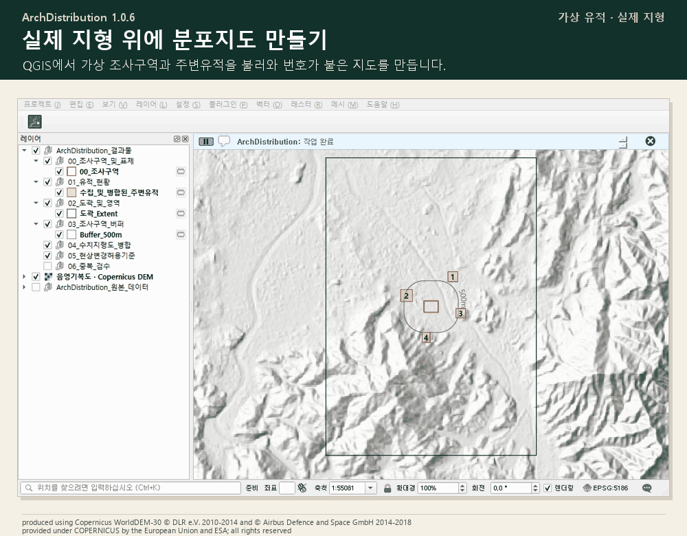

# ArchDistribution

조사구역 주변의 문화유산 자료를 모아 **번호가 붙은 분포지도**를 만드는 QGIS 플러그인입니다. 출처가 다른 기록은 중복 후보로 검토하고, 지도 번호와 원자료를 함께 관리할 수 있습니다.

Version: `1.0.6` · QGIS `3.40` 이상 · 한국어 / English

[설치](#설치) · [첫 분포지도 만들기](#첫-분포지도-만들기) · [사용 안내](docs/user-guide.md) · [변경 기록](CHANGELOG.md) · [English](#english)



## 설치

1. QGIS에서 **플러그인 → 플러그인 관리 및 설치**를 엽니다.
2. **ZIP 파일에서 설치**를 선택하고 `ArchDistribution-1.0.6.zip`을 엽니다. QGIS 플러그인 목록에서는 현재 공개된 버전을 설치할 수 있습니다.
3. 설치 후 도구 모음에서 **ArchDistribution** 아이콘을 누릅니다.

저장소에서 직접 설치 ZIP을 만들려면 아래 명령을 실행합니다. 배포 버전은 `metadata.txt`에서 읽습니다.

```bash
python create_zip.py
```

생성된 `ArchDistribution-1.0.6.zip`은 바탕화면에 있습니다. GitHub가 제공하는 소스 압축 파일은 QGIS 설치용 ZIP과 구조가 다릅니다.

## 첫 분포지도 만들기

[합성 예제 GeoPackage](examples/quick-start.gpkg?raw=true)로 GIF와 같은 흐름을 따라갈 수 있습니다. 조사구역과 유적은 모두 가상이며, 배경은 Hillshade Korea로 만든 실제 지형입니다. [배경 GeoTIFF](examples/quick-start-hillshade.tif?raw=true) · [배경 출처와 이용조건](docs/user-guide.md#예제-지형-출처)

1. 예제 파일을 QGIS에 불러오고 `가상 조사구역`과 `가상 유적분포지도`를 추가합니다. 배경 GeoTIFF를 함께 열었다면 레이어 목록 맨 아래에 놓습니다. 내 자료를 쓸 때는 조사구역 폴리곤과 주변유적 SHP 또는 GeoPackage를 준비합니다.
2. ArchDistribution의 **문화유적분포지도 → 데이터·도곽**에서 조사구역을 선택하고 주변유적 레이어를 체크합니다. 판형과 축척을 확인합니다.
3. 버퍼가 필요하면 **스타일·분석**에서 거리를 입력하고 추가합니다. 예제에서는 축척 `1:25,000`과 버퍼 `500 m`를 씁니다. 번호 순서도 여기서 바꿀 수 있습니다.
4. **분포지도 만들기**를 누릅니다. 검토 창이 열리면 후보를 **별도 유지**, **연결만**, **대표 번호로 묶기** 중에서 판단합니다.
5. 레이어 패널에서 `ArchDistribution_결과물`의 유적 번호를 확인합니다. 파일이 필요하면 **파일 저장**을 펼쳐 지도 생성 전에 출력 형식을 고릅니다.

**세부 설정**에서 자료 역할, 중복 판정, 지정·보호구역, 속성 제외, 지도 스타일을 조정할 수 있습니다. 화면을 접은 뒤에도 설정이 적용됩니다.

## 작업별 안내

| 작업 | 화면에서 여는 곳 |
| --- | --- |
| 지정·보호구역 또는 현상변경 허용기준을 함께 표시 | **문화유적분포지도 → 세부 설정** |
| 보존조치별로 매장유산 유존지역 도면 작성 | **매장유산 유존지역** 탭 |
| 중복 판정을 유지하며 기존 결과의 번호만 다시 정리 | **스타일·분석 → 기존 결과 후속 작업** |
| 결과와 처리 설정 보관 | **파일 저장 → GeoPackage + 실행정보(JSON)** |
| 인쇄용 지도와 보고서용 현황표 저장 | **파일 저장 → JPG / PDF / 주변유적 현황표(HWPX·CSV)** |

출처가 다른 지형과 기록이 겹친다는 사실만으로 유적의 동일성이 확정되지는 않습니다. 중복 후보의 처리와 지도 번호를 확인한 뒤 지도와 현황표를 원자료와 대조하세요. [중복 판정과 결과 확인 방법](docs/user-guide.md#중복-검토와-번호)

## 1.0.6의 주요 변경

- 입력과 지도 생성 버튼을 찾기 쉽게 정리했습니다. 세부 설정과 파일 저장은 필요할 때 펼칩니다.
- 같은 이름 규칙의 반복 변환과 레이어의 불필요한 읽기를 줄였습니다. 레이어 이름에 `_Copy`, `Consolidated`, `Dissolved`가 들어 있어도 선택할 수 있습니다.
- 웹 메르카토르 입력은 지역 UTM을 골라 거리를 계산합니다. 폴리곤의 경계만 닿으면 면적 중첩률은 0%입니다.
- 조사 결과가 불명확한 기록을 남기고, 현황표에서 주소의 지명과 확인 가능한 필지 수를 보존합니다.

이 버전에서 중복 판정 규칙이 바뀌었습니다. 원자료로 다시 분석하면 이전 규칙에서 저장한 중복 결정을 재확인합니다. [전체 변경 기록](CHANGELOG.md)

## English

ArchDistribution is a QGIS plugin for mapping archaeological sites and investigations around a study area. It keeps site records, investigation records, and map numbering distinct so you can review possible duplicates before using the map.

### Quick start in English

1. In QGIS, open **Plugins → Manage and Install Plugins**. Search for **ArchDistribution** or use **Install from ZIP** with an ArchDistribution plugin ZIP.
2. Open **ArchDistribution** from the toolbar and select **English** in the **Language** menu beside the help button. The choice applies immediately and is remembered. **Auto (QGIS)** uses Korean when QGIS is set to Korean and English for other locales.
3. In QGIS, load a study-area polygon and one or more heritage or investigation vector layers. To follow the public demo, add both layers from the [synthetic GeoPackage](examples/quick-start.gpkg?raw=true). Choose `가상 조사구역` as the study area in **Data and Layout**, and check `가상 유적분포지도` as the heritage layer. The [terrain backdrop](examples/quick-start-hillshade.tif?raw=true) is optional.
4. Set the paper size and scale under **Data and Layout**. In **Style and Analysis**, type a buffer distance in metres and select **Add (+)**. The demo uses **1:25,000** and **500 m**. Use **Advanced settings → Source Roles and Duplicate Matching** to review or change each input layer’s role.
5. To save outputs, open **Save files**, select an output folder, and choose the formats you need. **GeoPackage + run manifest (JSON)** saves the layers and execution record. Choose **Print-layout PDF** for the map or **Nearby-site table (HWPX, CSV)** for the numbered site list.
6. Select **Generate Distribution Map**. If the review dialog opens, choose **Keep separate**, **Link only**, or **Share one map number** for each candidate, then select **Generate with these decisions**. Check the map numbers and result layers under `ArchDistribution_결과물` in the QGIS Layers panel.

Keeping records separate gives them separate numbers. Linking records adds a relationship and keeps the separate numbers. Sharing a map number uses one number and one representative label while retaining the source records.

### Source data and Korean workflows

- Source layer names, field keys, and values stay as supplied. GeoPackage results retain stable field keys such as `번호` (map number), `유적명` (site name), and `NUMBER_KEY` (numbering group).
- The nearby-site table uses English column headings in English mode and summarizes records in their source languages. **Nearby-site table (HWPX, CSV)** produces both a Hangul document and a CSV when the map contains numbered sites.
- Designation, protection-zone, and change-zone overlays follow Korean source conventions, as does the separate buried-heritage preservation workflow. Leave those overlay inputs empty for a basic study-area map. The buffer sets an analysis distance. Designated and protection boundaries come from the selected source layers.

## 검증·제보·인용

- [검증 기록](validation/results/status.md)과 [연구 문서](docs/research)는 공개 합성 테스트, 통합 검증, 실제 업무 적용의 범위를 기록합니다. 전국 원자료와 실제 유적 좌표는 배포하지 않습니다.
- [문제 제보](https://github.com/lzpxilfe/ArchDistribution/issues)에는 QGIS와 플러그인 버전, 기대한 결과, 오류 메시지, 가상 재현 자료를 남겨 주세요. 로그는 QGIS 프로필의 `ArchDistribution/latest_log.txt`에 있습니다.
- 인용 정보는 [CITATION.cff](CITATION.cff), 기여 절차는 [CONTRIBUTING.md](CONTRIBUTING.md), 라이선스는 [LICENSES.md](LICENSES.md)에 있습니다.

```bibtex
@software{ArchDistribution2026,
  author = {{lzpxilfe(balguljang2)}},
  title = {ArchDistribution: A QGIS plugin for reconciling and mapping archaeological spatial records},
  year = {2026},
  url = {https://github.com/lzpxilfe/ArchDistribution},
  version = {1.0.6}
}
```
