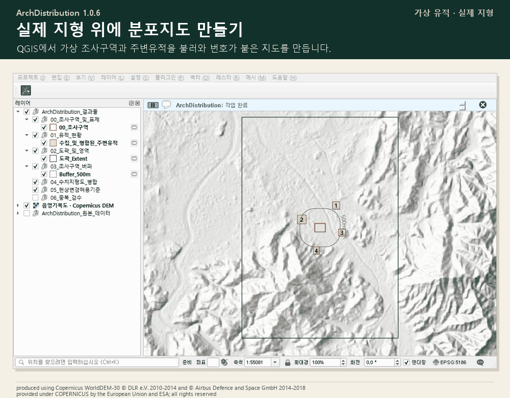

# ArchDistribution

**A QGIS plugin for reviewing archaeological records around a study area and producing numbered maps and site inventories.**

Bring a study-area polygon and your own heritage layers. ArchDistribution gathers records within the map extent, presents possible duplicates for review, and carries your decisions through to map numbering and the site inventory.

Version: `1.0.6` · QGIS `3.40` or later · [한국어](../README.md)

## Install

Open **Plugins → Manage and Install Plugins** in QGIS and search for **ArchDistribution**. Open the plugin from the toolbar and select **English** in the **Language** menu beside the help button. [Official QGIS plugin page](https://plugins.qgis.org/plugins/ArchDistribution/)

Build an installation ZIP from source

Download the repository and run `python create_zip.py` from its root. In the QGIS plugin manager, choose **Install from ZIP** and open the `ArchDistribution-1.0.6.zip` created on your desktop.

## Run the example

[Download the example GeoPackage](../examples/quick-start.gpkg?raw=true) · [Download the optional terrain backdrop](../examples/quick-start-hillshade.tif?raw=true)

1. Open the GeoPackage in QGIS and add both layers. `가상 조사구역` is the study area and `가상 유적분포지도` contains the example sites. If you load the terrain backdrop, place it below the vector layers.
2. Under **Data and Layout**, select the study area, check the site layer, and set the scale to **1:25,000**.
3. In **Style and Analysis**, enter `500` in the buffer distance field (in metres) and select **Add (+)**. For file exports, open **Save files** and select a folder and the formats you need.
4. Select **Generate Distribution Map**. If the review dialog opens, review the candidates and select **Generate with these decisions**. Check the numbered output in the `ArchDistribution_결과물` group in the QGIS Layers panel.

The study area and site features are synthetic. The optional backdrop shows real terrain from Copernicus DEM. [Example data and attribution](../examples/README.md)

## Work with your own data

| Task | What to use |
| --- | --- |
| Review records that may refer to the same site | **Keep separate** assigns individual numbers. **Link only** records a relationship and retains individual numbers. **Share one map number** uses one number and one map label while retaining the underlying records. |
| Add statutory boundaries and preservation actions | Supply the relevant designation, protection, or permitted alteration zone layers. The separate preservation-area workflow uses Korean buried-heritage data conventions. |
| Save a map, inventory, or audit trail | **Print-layout PDF** and JPG save the map. **Nearby-site table (HWPX, CSV)** saves the numbered inventory. **GeoPackage + run manifest (JSON)** saves the result layers, review tables, and run settings. |

Buffers set analysis distances. Statutory boundaries come from the selected source layers. English mode provides English inventory headings and preserves source values and existing GeoPackage field names. Check the results against your sources before using them in a report.

[Changelog](../CHANGELOG.md) · [Validation records](../validation/results/status.md) · [Report an issue](https://github.com/lzpxilfe/ArchDistribution/issues) · [Citation](../CITATION.cff) · [Licenses](../LICENSES.md)
